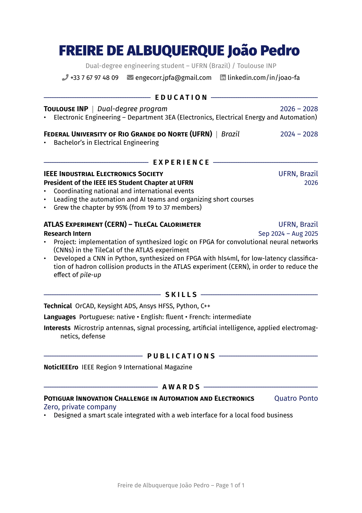
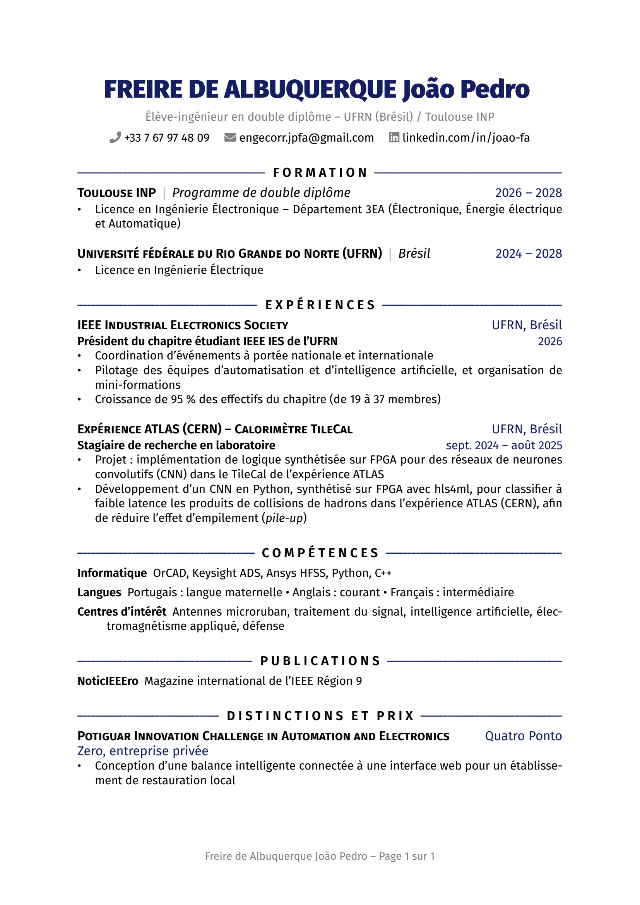

# Hello World! I'm João Pedro Albuquerque

**Electrical Engineering Undergrad · Dual-Degree Program (UFRN / Toulouse INP)**

Electrical engineering student with a strong interest in technologies applied to the aeronautical and aerospace sectors, especially radar engineering, antennas, and artificial intelligence. I’m a communicative and sociable person who wants to work in multidisciplinary, multicultural teams on projects I truly believe in, turning what I study into solutions that benefit society.

  <!-- LinkedIn -->
  
  <!-- Email -->
  

---

### 📄 Curriculum Vitae

<table align="center">
  <tr>
    <td align="center">
      
       
      <b>English</b> ·
      <a href="https://github.com/joaopedroFA/joaopedroFA/raw/main/cv/CV_Joao_Pedro_Freire_de_Albuquerque_EN.pdf">⬇️ Download</a>
    </td>
    <td align="center">
      
       
      <b>Français</b> ·
      <a href="https://github.com/joaopedroFA/joaopedroFA/raw/main/cv/CV_Joao_Pedro_Freire_de_Albuquerque_FR.pdf">⬇️ Télécharger</a>
    </td>
  </tr>
</table>

---

### 🧰 Languages and Tools

<!-- VHDL icon: save the UXWing SVG as assets/vhdl.svg -->

 

---

📺 **Latest YouTube Videos**

  
  

